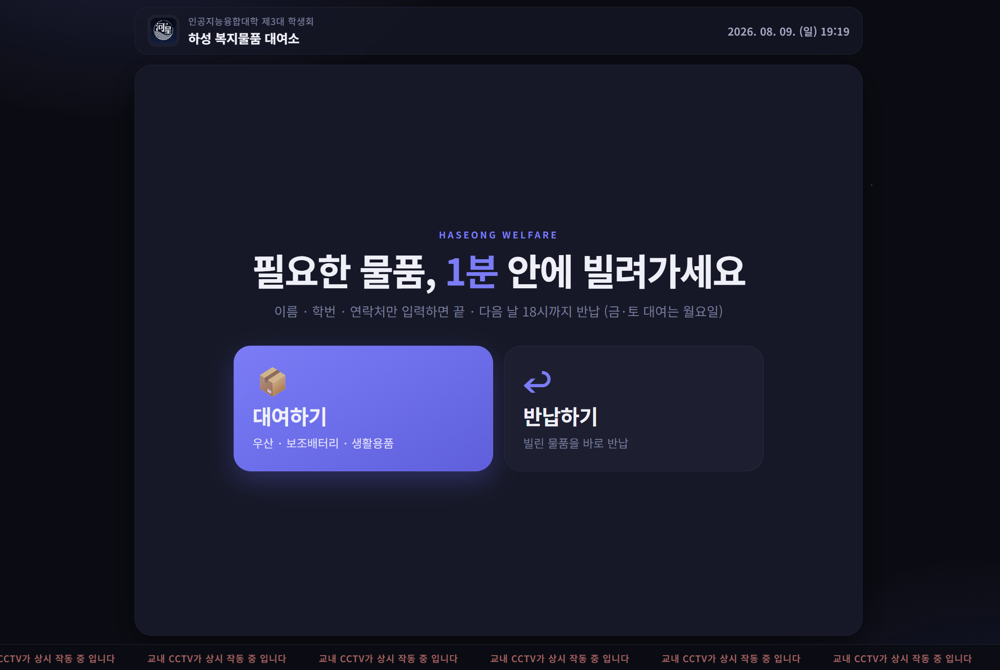
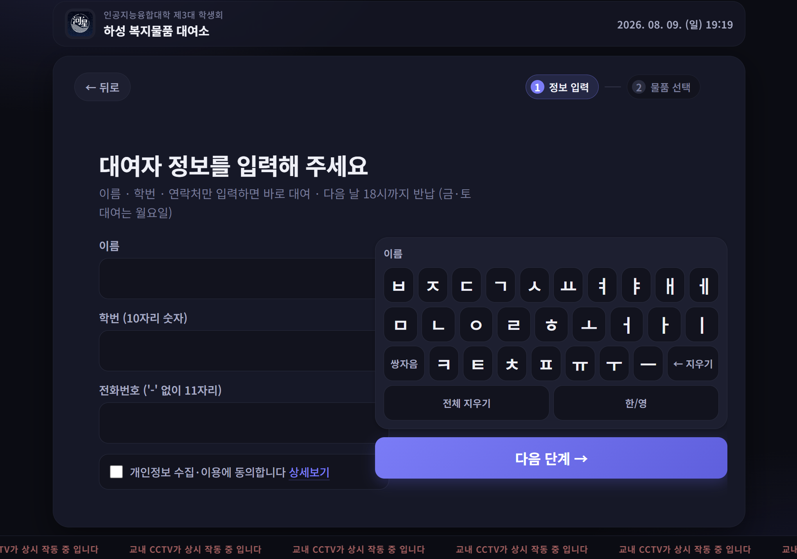
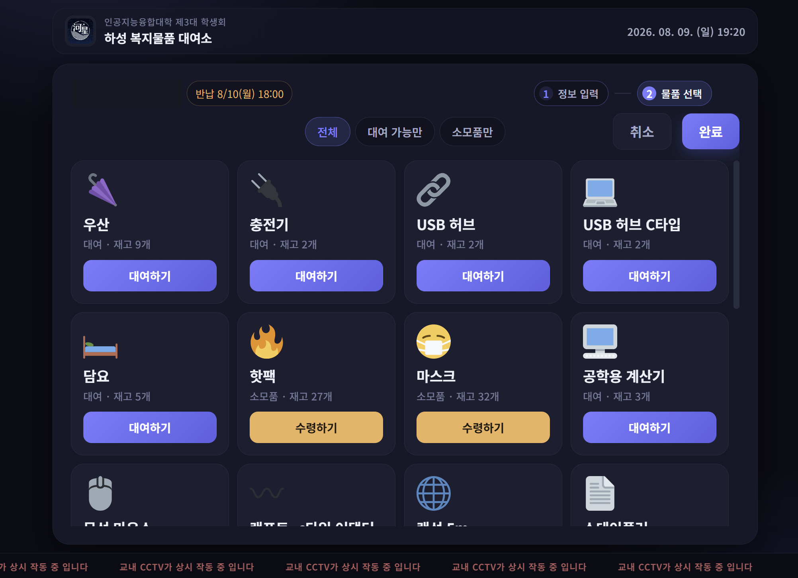
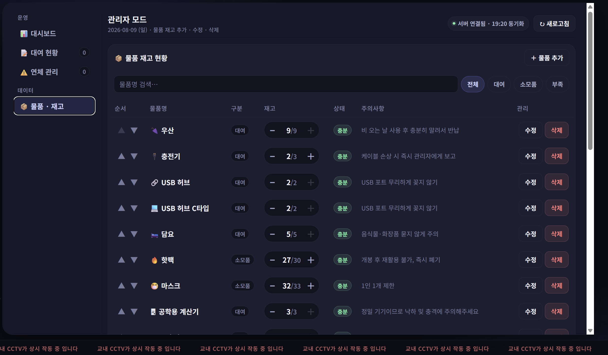

# 📦 하성 복지물품 대여소 키오스크

> **손으로 쓰던 학생회 대여 장부를, 학생회실 태블릿 한 대로 돌아가는 키오스크로 바꿨습니다.**
> 인공지능융합대학 학생회 하성의 복지물품 대여 · 반납 · 재고 관리를 1인 기획 · 개발 · 운영한 PWA입니다.

---

## 📊 운영 성과 (2026년 1학기, 3월 ~ 6월)

| 147건 | 42명 | 23종 | 1분 이내 |
| :---: | :---: | :---: | :---: |
| 누적 이용 세션 | 고유 이용 학생 | 운영 품목 (대여 16 · 소모품 7) | 대여 1건 처리 시간 |

- **최다 이용 물품**: 우산 · 충전기 · 공학용 계산기 · 담요 · 농구공
- **운영 환경**: 학생회실에 상시 거치된 태블릿(Galaxy Tab A 10.1, 2016년형) 1대
- **개발 기간**: 2026.01 ~ (운영 중) · 커밋 157개, 1인 개발

---

## 🙋 나의 역할

학생회 **하성 회장**으로서 문제 정의부터 실제 운영까지 혼자 맡았습니다.

- **기획** — 수기 장부 운영의 병목(대기 줄, 연체 누락, 재고 불일치, 인수인계 단절)을 정리하고 해결 방향 설정
- **개발** — 프론트(PWA) · 백엔드(Apps Script) · 데이터 모델(Google Sheets) 전체 구현
- **운영** — 학생회실 실기기에 배포하고, 실제 사용 중 나온 문제(네트워크 끊김, 동시 대여, 기기 렉 등)를 계속 개선

---

## 🎯 무엇을 해결했나

| 수기 장부의 문제 | 키오스크로 바꾼 것 |
| :--- | :--- |
| 이름 · 학번 · 연락처 · 물품 · 기한을 손으로 적느라 **대기 줄** 발생 | 터치 입력만으로 **1분 내 대여 · 반납** |
| 반납 기한을 사람이 계산해 **연체 누락** | 기한(다음 날 18시, 주말은 월요일) **자동 계산** + 연체 · 벌금 자동 집계 |
| 장부와 실제 **재고가 어긋남** | 서버가 재고를 직접 ±1 하고, 부족 품목 자동 표시 |
| 집행부가 바뀌면 **기록이 끊김** | 모든 기록이 Google Sheets에 남아 다음 집행부가 그대로 인수 |

| 정보 입력 (자체 한글 키패드) | 물품 선택 | 관리자 콘솔 |
| :---: | :---: | :---: |
|  |  |  |

---

## 💡 기술적 하이라이트

### 1. 개발자가 없어도 굴러가는 구조
학생회는 매년 사람이 바뀝니다. 그래서 **DB 대신 Google Sheets, 서버 대신 Apps Script, 빌드 없는 단일 HTML**을 택했습니다. 다음 집행부가 시트를 열어 재고를 고치고, 파일만 고쳐 GitHub Pages에 올리면 반영됩니다. 서버 비용은 0원입니다. (Vue로 다시 만들어 보다가 이 이유로 접었습니다)

### 2. 끊기는 Wi-Fi에서도 기록이 사라지지 않게
학생회실 Wi-Fi가 자주 끊겨 대여 기록이 유실됐습니다. 실패한 요청을 **재시도 큐에 쌓고 지수 백오프로 재전송**하도록 만들어, 앱을 껐다 켜도 이어서 전송됩니다.

### 3. 소스에 API 키가 보이는 구조에서의 보안
정적 사이트라 API 키가 숨겨지지 않습니다. 그래서
- 재고는 클라이언트가 계산한 값 대신 **서버가 직접 ±1** 하고
- 관리자 비밀번호 해시가 없으면 관리자 기능을 **전부 거부(fail-closed)** 하며
- 일반 사용자 응답에서는 **이름 · 연락처를 서버가 제거**하도록 권한을 나눴습니다.

### 4. 동시 대여 · 중복 클릭 대응
여러 명이 동시에 빌리거나 버튼을 두 번 누르면 재고가 음수가 되던 문제를, 쓰기 요청 직렬화(`LockService`)와 `(학번, 물품명)` 기준 중복 판정, 멱등 반납으로 해결했습니다.

### 5. 개인정보는 필요한 만큼만, 필요한 동안만
태블릿에는 학번 · 물품 · 기한만 남기고, 이름 · 연락처는 서버에만 둡니다. 대여 기록은 반납 시 삭제하고, 이용 로그는 상한을 넘으면 오래된 것부터 자동 삭제합니다.

### 6. 키오스크다운 입력 경험
태블릿 기본 키보드는 레이아웃을 깨고 한글 조합이 불안정해, **한글 · 숫자 키패드를 직접 만들어** 기기와 상관없이 같은 입력 경험을 제공합니다.

---

## 🛠️ 기술 스택

| 구분 | 사용 기술 |
| :--- | :--- |
| Frontend | HTML5, CSS3, Vanilla JavaScript |
| App | PWA (Service Worker, Web App Manifest), LocalStorage |
| Backend | Google Apps Script (Web App API) |
| Data | Google Sheets |
| Deploy | GitHub Pages, Apps Script 배포 |

---

## 📝 배운 점

- **기술 선택의 기준은 "누가 유지보수하는가"다.** 최신 스택보다 다음 사람이 이어받을 수 있는 구조가 서비스 수명을 결정한다는 걸 배웠습니다.
- **실제 사용자는 개발 환경과 다르다.** 2016년형 태블릿과 불안정한 Wi-Fi에서 직접 운영해 보며 오프라인 대응, 렉 원인 제거 같은 문제를 현장에서 찾아 고쳤습니다.
- **작은 서비스도 개인정보는 무겁다.** 학우들의 실명 · 연락처를 다루면서 최소 수집 · 최소 보관 원칙을 설계 단계부터 넣게 됐습니다.

---

## 📚 더 보기

- 📐 [개발 · 유지보수 문서](docs/DEVELOPMENT.md) — 아키텍처, 데이터 모델, 트러블슈팅 7건 상세, 권한 구분, 설치 · 배포 방법, 유지보수 노트
- 🔗 [Live Demo](https://noeyeas.github.io/hasung-welfare-kiosk/)
